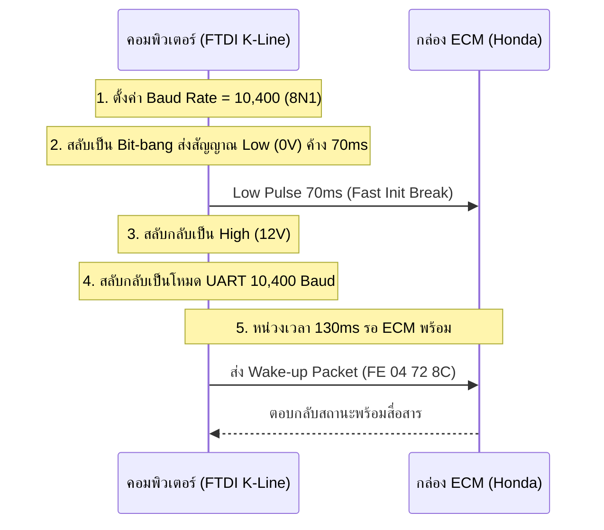

# เอกสารวิเคราะห์การทำงานเชิงลึก: Honda K-Line Flasher & Protocols

เอกสารนี้รวบรวมข้อมูลเชิงเทคนิค การทำงานของวงจรฮาร์ดแวร์ โปรโตคอลการสื่อสาร K-Line (ISO 14230 / KWP2000), สูตรคณิตศาสตร์ Seed-Key, การคำนวณ Checksum, และโครงสร้างแพ็กเก็ตของกล่อง ECM มอเตอร์ไซค์ Honda ทั้งหมด

---

## 1. การทำงานของชั้นกายภาพ (Physical Layer & Hardware)

### โครงสร้างสาย K-Line
- **ลักษณะการสื่อสาร**: Single-wire Half-Duplex (สายเส้นเดียว ส่งและรับบนสายเดียวกัน)
- **ระดับแรงดัน**: 0V - 12V (Low = Dominant/0V, High = Recessive/12V Pull-up)
- **ชิปเชื่อมต่อ**: FTDI FT232RL / FT232R ต่อร่วมกับตัวแปลงระดับแรงดัน (K-Line Transceiver เช่น L9637D, MC33660 หรือวงจรทรานซิสเตอร์ Pull-up 510 $\Omega$ เข้า 12V)
- **ปรากฏการณ์ TX Echo**: เนื่องจากสาย TX และ RX เชื่อมต่อกันที่สาย K-Line เมื่อคอมพิวเตอร์ส่งข้อมูลออกไป ข้อมูลที่ส่งจะสะท้อนกลับมาที่พอร์ต RX ทันที โปรแกรมจึงต้องกรองข้อมูล Echo ความยาวเท่ากับขนาดคำสั่งที่ส่งออกไปก่อนที่จะอ่านข้อมูลตอบกลับจากกล่อง ECM

---

## 2. ลำดับการเริ่มต้นสื่อสาร (ISO 14230-2 Fast Initialization)

ก่อนที่กล่อง ECM จะตอบสนอง โปรแกรมต้องส่งสัญญาณกระตุ้น (Wake-Up Pattern):

---

## 3. รูปแบบแพ็กเก็ตและสูตร Checksum ของ Honda

### โครงสร้างแพ็กเก็ต (Packet Format)
$$\text{[Header]} + \text{[Length]} + \text{[Service / Data Bytes...]} + \text{[Checksum]}$$

- **Header**:
  - `0xFE`: Tester Present / Wakeup
  - `0x72`: Diagnostic Data Request / Reset / DTC
  - `0x7D` / `0x7E`: Keihin Service Packets
  - `0x7B` / `0x7C`: Shindengen Service Packets
- **Length**: ความยาวรวมทั้งหมดของแพ็กเก็ต (รวม Header, Length, Data และ Checksum)
- **Checksum**: ผลลัพธ์จากการคำนวณแบบ **Two's Complement**

### สูตรการคำนวณ Checksum ของ Honda (Checksum8BitHonda)
$$\text{Checksum} = ((\sum_{i=0}^{N-1} \text{Byte}_i \oplus 0\text{xFF}) + 1) \ \& \ 0\text{xFF}$$
หรือมีค่าเท่ากับ:
$$\text{Checksum} = (0\text{x}100 - (\sum \text{Byte}_i \ \& \ 0\text{xFF})) \ \& \ 0\text{xFF}$$

---

## 4. ชุดคำสั่งมาตรฐาน (Command Reference)

| คำสั่ง (Hex) | หน้าที่ | คำอธิบาย |
| :--- | :--- | :--- |
| `FE 04 72 8C` | **Wake-up / Tester Present** | ปลุกและตรวจสอบการเชื่อมต่อกับกล่อง ECM |
| `72 05 00 F0 99` | **Read ECM ID (Table 00 F0)** | อ่านรหัสไอดีประจำตัวของกล่อง ECM |
| `72 07 72 00 00 05 10` | **Read ECM ID (Table 00 Offset 00)** | คำสั่งอ่านรหัสกล่อง ECM แบบทางเลือก |
| `7D 06 01 01 03 78` | **Read Flash Count (Keihin)** | อ่านจำนวนครั้งที่เคยเขียนแฟลชกล่อง Keihin |
| `7B 06 02 01 03 79` | **Read Flash Count (Shindengen)** | อ่านจำนวนครั้งที่เคยเขียนแฟลชกล่อง Shindengen |
| `72 05 60 01 28` | **Clear DTC** | ลบโค้ดประวัติความผิดปกติในหน่วยความจำ |
| `72 05 60 03 26` | **Reset ECM** | รีเซ็ตค่าการปรับตัว (Adaptations) ของ ECM |
| `7E 07 01 0E 01 90 DB` | **Set Fast Baud Rate (Keihin)** | สลับความเร็วสื่อสาร Keihin เป็น 62,500 baud |
| `7C 07 02 0E 01 00 6C` | **Set Fast Baud Rate (Shindengen)** | สลับความเร็วสื่อสาร Shindengen เป็น 62,500 baud |
| `7E 0B 01 0B 00 00 00 FF FF FF 6E` | **Erase Flash (Keihin)** | สั่งลบหน่วยความจำ Flash ของ Keihin |
| `7C 0B 02 0B 00 00 00 FF FF FF 6F` | **Erase Flash (Shindengen)** | สั่งลบหน่วยความจำ Flash ของ Shindengen |

---

## 5. อัลกอริทึมการถอดรหัส Seed-Key (Shindengen Security Access)

กล่อง Shindengen (เช่น PCX160, Lead125 4V, Click160, ADV160, Giorno 125) ใช้ระบบความปลอดภัยแบบ Challenge-Response:

### 1. ขั้นตอน Write Key (เขียนแฟลช)
1. โปรแกรมส่งคำขอ Seed: `7B 07 02 05 00 00 00 [Checksum]`
2. กล่อง ECM ตอบกลับ Seed 2 ไบต์: $[S_0, S_1]$
3. โปรแกรมค้นหา Signature `11 12 13 14 15 15 17` ในไฟล์ BIN
4. ที่ตำแหน่งต่อจาก Signature โปรแกรมจะค้นหาตัวระบุ `0xEE` และ `0x00 / 0xFF` เพื่อดึงค่าพารามิเตอร์ 3 ตัว:
   - $V_5 = \text{LittleEndian}(\text{BIN}[0..1])$
   - $V_6 = \text{LittleEndian}(\text{BIN}[2..3])$
   - $V_7 = \text{LittleEndian}(\text{BIN}[4..5])$
5. คำนวณรหัสกุญแจ (Key):
   $$\text{SeedValue} = (S_0 \ll 8) \mid S_1$$
   $$V_8 = (V_6 \times (\text{SeedValue} + V_5)) \ \& \ 0\text{xFFFF}$$
   $$\text{KeyValue} = \begin{cases} (V_8 + (\text{SeedValue} \pmod{V_7})) \ \& \ 0\text{xFFFF} & \text{ถ้า } V_7 > 0 \\ (V_8 + \text{SeedValue}) \ \& \ 0\text{xFFFF} & \text{ถ้า } V_7 = 0 \end{cases}$$
6. ส่งรหัสตอบกลับไปยัง ECM: `7B 07 02 06 [Key_High] [Key_Low] [Checksum]`

### 2. ขั้นตอน Recovery Key (กู้ชีพกล่อง)
- ค้นหา Signature `91 91 0D 00 9E 8D` แล้วดึงพารามิเตอร์ 6 ไบต์ด้านหน้าเพื่อคำนวณกุญแจกู้คืน

---

## 6. อัลกอริทึมการคำนวณ Checksum ไฟล์ BIN

### 1. กล่อง Keihin (8-bit Sum)
- คำนวณผลรวม 8-bit ของทุกไบต์ในไฟล์ ยกเว้นตำแหน่ง `ChecksumOffset`
$$\text{Sum} = \sum_{i \neq \text{ChecksumOffset}} \text{BIN}[i] \pmod{256}$$
- กำหนดค่า Checksum:
$$\text{BIN}[\text{ChecksumOffset}] = (-\text{Sum}) \ \& \ 0\text{xFF}$$
- ส่งผลให้ $\sum_{i=0}^{\text{FileSize}-1} \text{BIN}[i] \equiv 0 \pmod{256}$

### 2. กล่อง Shindengen (32-bit Little-Endian Sum)
- ค้นหา Signature `11 12 13 14 15 15 17` และตัวระบุ `D0 07` เพื่อหาตำแหน่ง Checksum (ขนาด 4 ไบต์)
- คำนวณผลรวม 32-bit ของข้อมูลก่อนและหลังช่อง Checksum:
$$\text{TotalSum} = \sum \text{WordsBefore} + \sum \text{WordsAfter}$$
- คำนวณค่า Checksum 32-bit:
$$\text{Checksum32} = (0 - \text{TotalSum}) \ \& \ 0\text{xFFFFFFFF}$$
- บันทึกค่า 4 ไบต์แบบ Little-Endian ลงในตำแหน่ง Checksum ของไฟล์

---

## 7. เครื่องมือปลดรหัส TunerPro และแปลงไฟล์

### TunerPro Password Remover
- **Master Key**: `$9Ad0$!#*)1QqPow^`
- **Algorithm**: `MD5(MasterKey)` สร้าง Key 128-bit แล้วถอดรหัสด้วย `RC4`
- โปรแกรมจะตัดแท็ก `<openpassword>` และ `<modifypassword>` ออก พร้อมปรับแก้ `<flags>` ให้ไฟล์เปิดได้ทันทีโดยไม่ต้องใส่รหัส

### ACG & ECU Decrypter
- **.ACG Key**: `@Shinden@9919` (ถอดรหัสด้วย Rijndael CBC Mode)
- **.ECU Key**: `@ecu_homdaa!&2023*mnhdaK#^&hcbaHBQD@0lanmBV#!` (ถอดรหัสด้วย Rijndael CBC Mode)
