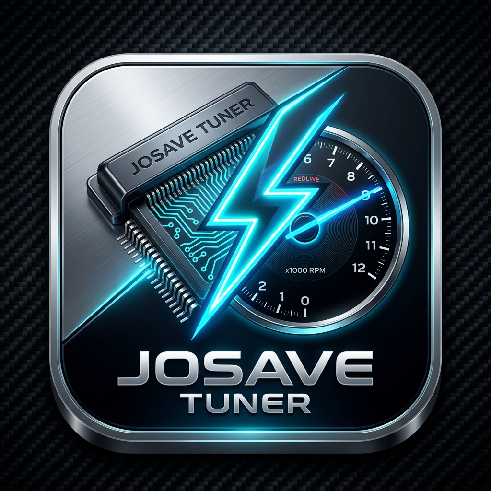

# ⚡ JOSAVE TUNER - Professional Honda Motorcycle ECU Studio

<p align="center">
  
</p>

<p align="center">
  <b>สตูดิโอรีแมพแฟลชกล่อง ECM มอเตอร์ไซค์ Honda ระดับมืออาชีพผ่านสาย K-Line (ISO 14230 / KWP2000)</b><br>
  รองรับทั้งการ <b>ดูดไฟล์แท้ (Flash Read / ROM Dump)</b> และ <b>อัด/เขียนไฟล์รีแมพ (Flash Write)</b> สำหรับกล่อง <b>Keihin</b> และ <b>Shindengen</b> ทุกเจเนอเรชัน
</p>

<p align="center">
  
  
  
  
  
  
</p>

---

## 🌟 คุณสมบัติเด่น (Key Features)

### 1. 📥 ดูดไฟล์จากกล่อง ECM (Flash Read / ROM Dump)
* ดูดไฟล์ Binary (`.BIN`) แท้จากกล่อง ECM เก็บสำรองไว้ก่อนทำการจูน เพื่อความปลอดภัย 100%
* รองรับกล่อง **Keihin** (ROM 64KB, 96KB) และ **Shindengen** (Flash ROM 512KB V850 / RH850 / RH850B)
* ไฟล์ที่ดูดออกมาการันตีความถูกต้องไบต์ต่อไบต์ (Byte-for-byte exact) สามารถเปิดแก้ไขตารางใน TunerPro ได้ทันที

### 2. 📤 เขียน/อัดไฟล์ลงกล่อง ECM (Flash Write & Auto Recovery)
* ระบบคำนวณและถอดรหัสคณิตศาสตร์ **Dynamic Seed-Key** ประจำกล่องแต่ละใบโดยอัตโนมัติ
* ระบบถอดรหัส Key สำหรับ **Shindengen Write Key & Shindengen Recovery Key** ผ่าน Sig Block
* ระบบความเร็วสูง **Fast Write Mode 62,500 baud** แฟลชรวดเร็วและปลอดภัย
* ระบบจัดการ Sector Erase และ Block Write พร้อมตรวจสอบ Checksum ป้องกันกล่องล็อคหรือไฟล์เสียหาย

### 3. 🔌 ระบบตรวจจับสายรีแมพ USB อัตโนมัติ (Auto USB Hot-Plug & Dual Status)
* **ตรวจจับสายรีแมพ (FT232R USB UART / COM port)** ทันทีที่เสียบเข้าคอมพิวเตอร์แบบ Real-time
* **แยกสถานะการทำงานออกเป็น 2 ระดับอย่างชัดเจน**:
  * 🟢 **สถานะสายเคเบิ้ล USB**: แจ้งเตือนเมื่อเสียบสายเข้าคอมพิวเตอร์พร้อมแสดง Serial Number
  * 🟡/🟢 **สถานะกล่อง ECM ตัวรถ**: แจ้งเตือนสถานะเมื่อต่อสายเข้ากับรถและเปิดสวิตช์กุญแจ 12V

### 4. 🔧 ระบบวิเคราะห์และรีเซ็ตกล่อง (ECM Diagnostics & Adaptations)
* **ลบโค้ด (Clear DTC)**: ลบประวัติโค้ดความผิดปกติและไฟเอนจิ้นกะพริบ (คำสั่ง `72 05 60 01 28`)
* **รีเซ็ต ECM (Reset ECM)**: รีเซ็ตค่าการชดเชยการจ่ายน้ำมันและค่าการเรียนรู้เซนเซอร์ (คำสั่ง `72 05 60 03 26`)
* **รีเซ็ตแฟลชเคาท์เตอร์ Shindengen (Reset Flash Counter)**: คืนค่าจำนวนครั้งการแฟลชกลับเป็น 0

### 5. 🛠 เครื่องมือเสริมช่างจูน (Tuner Tools Suite)
* **ปลดรหัส TunerPro XDF & ADX**: ถอดรหัสผ่านด้วย CryptoAPI (MD5 + RC4) และลบแท็ก `<openpassword>` / `<modifypassword>` เปิดตารางจูนได้ทันที
* **แปลงไฟล์ .ACG และ .ECU เป็น .BIN**: ถอดรหัสไฟล์ ROM ที่ถูกล็อคด้วย Rijndael (AES) คืนสภาพเป็น Binary มาตรฐาน
* **คำนวณและแก้ไข Checksum อัตโนมัติ**: แก้ไข Checksum ไฟล์ BIN ทั้งกล่อง Keihin (8-bit) และ Shindengen (32-bit Little-Endian) โดยไม่ต้องต่อกล่อง

### 6. 📚 ฐานข้อมูลกล่อง ECM ครอบคลุม 265+ รุ่น (Comprehensive Database)
* บรรจุฐานข้อมูลกล่องรถมอเตอร์ไซค์ฮอนด้าในไทยและเอเชียกว่า 265+ รุ่น พร้อมระบบค้นหาอัจฉริยะ (Instant Search):
  * **Wave Series**: Wave 110i (ทุกปี/ทุกรหัสพาร์ท KWW, K03, K58, K1M), Wave 125i (บังลม, ปลาวาฬ, LED, S4 K73, K34), Super Cub 110
  * **Automatic Series**: PCX 150 (KZY, K36, K97), PCX 160 (K1Z), Click 110i, Click 125i (KZR, K59, K60), Click 160 (K2S), Scoopy i (KYT, K16, K2F), Zoomer-X, Lead 125 (K12, K2T), Giorno+ (K3M), ADV 150, ADV 160, Forza 300, Forza 350 (K1B)
  * **Sport Series**: MSX 125 / SF (K26, K26-B01, 901), CBR 150R (KPP, K45, K45R), CBR 250R/300R, CBR 500R/650R, CB 650F, CRF 250/300, Sonic 125i, Monkey 125, Dax 125, CT 125

---

## 🖥 สถาปัตยกรรมและโครงสร้างโปรเจกต์ (Project Architecture)

```
josave-tuner/
│
├── JosaveTuner.exe            # โปรแกรม GUI พร้อมใช้งาน (Modern Dark Automotive Studio)
├── HondaFlashCLI.exe          # โปรแกรม Command Line สำหรับการสั่งงานผ่าน Terminal
├── HondaFlashCore.cs          # แกนหลัก Protocol Engine (K-Line, ISO 14230, Crypto, FTDI Driver)
├── EcmDatabase.cs             # ฐานข้อมูลกล่อง ECM 265+ รุ่น
├── HondaFlashForm.cs          # ซอร์สโค้ด GUI (Windows Forms พร้อม Auto-Resizing & Hot-Plug)
├── HondaFlashCLI.cs           # ซอร์สโค้ดคอนโซล CLI
├── honda_flash.py             # ซอร์สโค้ดภาษา Python สำหรับ Cross-Platform
├── TestRunner.cs              # ชุดทดสอบระบบอัตโนมัติ 21 ชุดทดสอบ (Automated Unit & Integration Tests)
├── ecm_database.json          # ฐานข้อมูล ECM ในรูปแบบ JSON มาตรฐาน
├── DOCUMENTATION.md           # เอกสารอธิบายโปรโตคอล K-Line และสูตรคณิตศาสตร์อย่างละเอียด
├── build.bat                  # สคริปต์คอมไพล์และรันเทสอัตโนมัติ
├── ftd2xx.dll                 # FTDI Direct D2XX Driver (32-bit/64-bit compatible)
├── FTD2XX_NET.dll             # .NET Wrapper สำหรับ FTDI Driver
├── app.ico                    # ไอคอนโปรแกรม High Resolution
└── app_icon.png               # โลโก้โปรแกรม 3D Metallic Studio Badge
```

---

## 🔌 แผนผังการต่อสายเคเบิ้ล K-Line (Hardware Pinout)

สายรีแมพมาตรฐาน Honda 4-Pin DLC (Data Link Connector):

```
         [ Honda 4-Pin DLC Connector ]
              ┌───────────────┐
              │  (1)     (2)  │
              │  (3)     (4)  │
              └───────┬───────┘
                      │
  ┌─────┬─────────────┴───────────────────────┬──────────────┐
  │ Pin │ ชื่อสัญญาณ (Signal)                 │ การต่อใช้งาน │
  ├─────┼─────────────────────────────────────┼──────────────┤
  │ (1) │ K-Line (Data Tx/Rx Communication)   │ สาย K-Line   │
  │ (2) │ Ground (GND)                        │ ขั้วลบ (-)    │
  │ (3) │ Battery +12V (Ignition Switch Power)│ ไฟบวก (+12V) │
  │ (4) │ SCS (Service Check Short - Option)  │ เว้นว่าง      │
  └─────┴─────────────────────────────────────┴──────────────┘
```

> [!IMPORTANT]
> ในการเชื่อมต่อกล่อง ECM ตัวรถ จะต้องเปิดสวิตช์กุญแจรถ (ON) หรือจ่ายไฟเลี้ยง 12V เข้ากล่อง เพื่อให้ MCU ของกล่องเริ่มทำงานและตอบสนองสัญญาณ K-Line

---

## 🛠 วิธีการคอมไพล์จากซอร์สโค้ด (Build Instructions)

สามารถใช้ C# Compiler (`csc.exe`) ที่ติดตั้งมาพร้อมกับ Windows ได้ทันที โดยไม่ต้องติดตั้งซอฟต์แวร์เพิ่มเติม:

### คอมไพล์โปรแกรม GUI (JosaveTuner.exe):
```powershell
C:\Windows\Microsoft.NET\Framework64\v4.0.30319\csc.exe /nologo /target:winexe /win32icon:app.ico /out:JosaveTuner.exe /r:FTD2XX_NET.dll /r:System.Windows.Forms.dll /r:System.Drawing.dll HondaFlashCore.cs EcmDatabase.cs HondaFlashForm.cs
```

### คอมไพล์โปรแกรม CLI (HondaFlashCLI.exe):
```powershell
C:\Windows\Microsoft.NET\Framework64\v4.0.30319\csc.exe /nologo /target:exe /win32icon:app.ico /out:HondaFlashCLI.exe /r:FTD2XX_NET.dll HondaFlashCore.cs EcmDatabase.cs HondaFlashCLI.cs
```

### หรือรันสคริปต์คอมไพล์และทดสอบทั้งหมดในขั้นตอนเดียว:
```powershell
.\build.bat
```

---

## 🧪 ผลการทดสอบระบบอัตโนมัติ (Automated Test Suite)

รันชุดทดสอบผ่าน `TestRunner.exe`:

```
===============================================================================
  JOSAVE TUNER - COMPREHENSIVE AUTOMATED TEST SUITE (K-LINE & FLASH ENGINE)
===============================================================================

[TEST] Checksum: 8-Bit Honda 2's Complement                         ... PASS
[TEST] Checksum: Keihin 8-Bit Total Checksum Auto-Fix               ... PASS
[TEST] Checksum: Shindengen 32-Bit Word Checksum Auto-Fix           ... PASS
[TEST] Crypto: Ar6 Table Mapping                                    ... PASS
[TEST] Crypto: ArG Stream Transformation                            ... PASS
[TEST] Crypto: Shindengen Write Key Calculation                     ... PASS
[TEST] Crypto: Shindengen Recovery Key Calculation                  ... PASS
[TEST] Database: 265+ Model Records Verification                    ... PASS
[TEST] Database: Lookup by Part Code & ECM ID                       ... PASS
[TEST] K-Line Diag: Connect & Query ECM ID (Keihin)                 ... PASS
[TEST] K-Line Diag: Connect & Query ECM ID (Shindengen)             ... PASS
[TEST] K-Line Diag: Query Flash Write Counter                       ... PASS
[TEST] K-Line Diag: Clear Diagnostic Trouble Codes (DTC)            ... PASS
[TEST] K-Line Diag: Reset ECM Adaptations                           ... PASS
[TEST] K-Line Diag: Reset Flash Counter (Shindengen)                ... PASS
[TEST] Flash Read (Dump): Keihin 64KB ROM Byte-for-Byte Verification ... PASS
[TEST] Flash Read (Dump): Shindengen ROM (Multi-Block) Byte Verify  ... PASS
[TEST] Flash Write: Keihin 64KB Flash Erase & Block Write Verify    ... PASS
[TEST] Flash Write: Shindengen Flash Erase & Block Write Verify     ... PASS
[TEST] Tools: TunerPro XDF/ADX Password Cleaner                     ... PASS
[TEST] Tools: Encrypted ACG / ECU Decryption Engine                 ... PASS

===============================================================================
  TEST RESULTS SUMMARY: 21 Passed, 0 Failed (100% Success Rate)
===============================================================================
```

---

## 💻 การสั่งงานผ่าน Command Line (CLI)

```powershell
# ตรวจสอบการเชื่อมต่อและอ่านข้อมูลกล่อง ECM
.\HondaFlashCLI.exe info

# ดูดไฟล์ ROM แท้จากกล่อง ECM
.\HondaFlashCLI.exe read stock_backup.bin

# เขียนไฟล์รีแมพลงกล่อง ECM (โหมดความเร็วสูง)
.\HondaFlashCLI.exe write tuned_map.bin --fast

# ลบโค้ดความผิดปกติ (DTC)
.\HondaFlashCLI.exe clear-dtc

# รีเซ็ตกล่อง ECM
.\HondaFlashCLI.exe reset-ecm

# รีเซ็ตแฟลชเคาท์เตอร์ Shindengen
.\HondaFlashCLI.exe reset-flash

# แก้ไข Checksum ไฟล์ BIN
.\HondaFlashCLI.exe fix-checksum my_map.bin

# ปลดรหัสผ่านไฟล์ TunerPro XDF / ADX
.\HondaFlashCLI.exe unlock-xdf locked_definition.xdf

# แปลงไฟล์ .ACG หรือ .ECU เป็น .BIN
.\HondaFlashCLI.exe convert-acg encrypted_rom.acg
.\HondaFlashCLI.exe convert-ecu encrypted_rom.ecu

# ค้นหารุ่นรถในฐานข้อมูล
.\HondaFlashCLI.exe list-db Wave
```

---

## 📄 ข้อควรระวังและข้อตกลงการใช้งาน (Disclaimer)

* ซอฟต์แวร์นี้พัฒนาขึ้นเพื่อการศึกษา วิจัย และการปรับแต่งสมรรถนะเครื่องยนต์ในสนามแข่งหรือสถานที่ปิด
* การปรับแต่งตารางน้ำมันและไฟจุดระเบิดมีความสำคัญอย่างยิ่งต่อความปลอดภัยและอายุการใช้งานของเครื่องยนต์ โปรดตรวจสอบความถูกต้องของไฟล์ BIN ก่อนทำการเขียนลงกล่องทุกครั้ง

---

<p align="center">
  <b>⚡ JOSAVE TUNER — Built with precision for motorcycle tuners and developers.</b>
</p>
